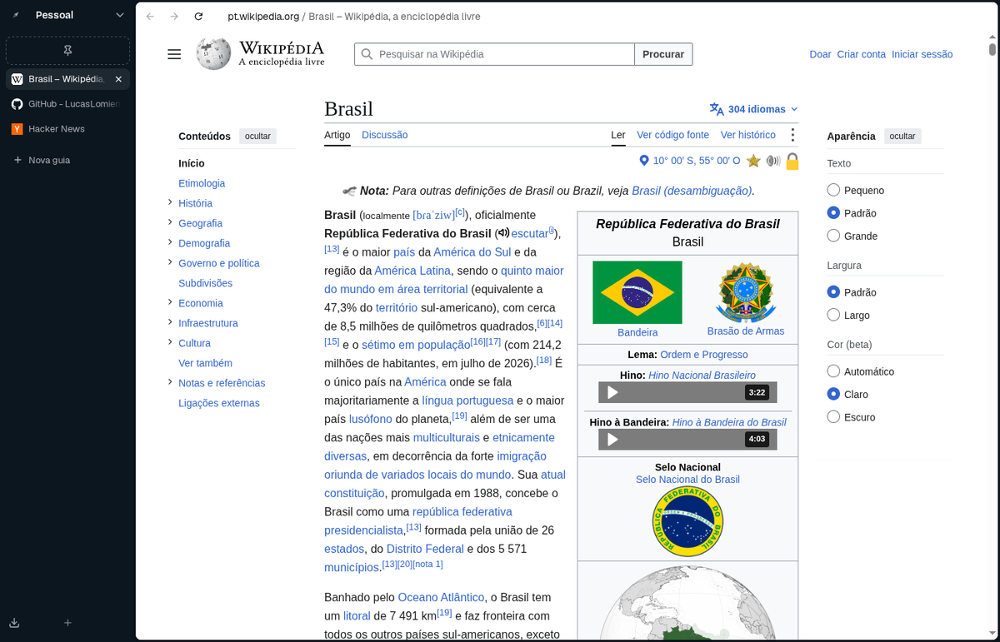

# Navegador

**Site:** [lucaslomiento.github.io/navegador](https://lucaslomiento.github.io/navegador/)

Um navegador em cima do Chromium, com as abas numa lateral, **espaços**, **containers** e um **bloqueador de anúncios** embutido. Escuro, minimalista e sem recursos de IA.

## Recursos

- **Lateral com as abas.** Some com `Ctrl+S` e volta por cima da página quando o ponteiro encosta na borda esquerda.
- **Espaços.** Cada espaço tem as próprias abas, sites fixados, pastas e favoritos, e uma cor. Para trocar: o nome no alto da lateral, os botões laterais do mouse em cima dela ou `Ctrl+Alt+←/→`.
- **Containers.** Cookies e logins separados dentro do mesmo perfil, como os do Firefox. Cada espaço pode abrir as abas num container.
- **Vários perfis**, cada um na própria janela.
- **Bloqueador de anúncios e rastreadores.** Usa a EasyList, a EasyPrivacy, a EasyList Portuguese e os consertos do uBlock Origin. Barra as requisições, esconde os espaços dos anúncios e conserta os sites que dependem dos scripts barrados. Dá para liberar um site pelo ícone dele na barra de endereço.
- **Nova aba personalizável**, com hora, data e atalhos: os mais visitados, uma lista sua ou nada.
- **Barra na cor do site**, que pega a cor do topo da página aberta.
- **Importar do Zen**: containers, espaços, sites fixados, cookies de cada container, senhas, favoritos e histórico.
- **Atualiza sozinho**: avisa no pé da lateral quando sai versão nova.
- **Sem IA, sem conta Google e sem estatísticas de uso.**

## Instalar

As versões ficam em [LucasLomiento/navegador-releases](https://github.com/LucasLomiento/navegador-releases).

- **Arch Linux e derivados** (CachyOS, EndeavourOS, Manjaro): pelo repositório do pacman, que atualiza junto com o sistema. O passo a passo está no README de lá.
- **Windows:** ainda não tem versão pronta. O código já está preparado (ver "Compilar"), falta testar.

## Compilar

O repositório guarda só o que é do Navegador: as mudanças nos arquivos do Chromium (`patches/`), o código novo (`navegador/`) e os scripts (`tools/`). O Chromium é baixado à parte, na versão de `CHROMIUM_VERSION`.

1. Instale o [depot_tools](https://commondatastorage.googleapis.com/chrome-infra-docs/flat/depot_tools/docs/html/depot_tools_tutorial.html) e baixe o Chromium da tag de `CHROMIUM_VERSION` com o `gclient`. Use uma solução `src` com `"managed": False`.
2. `tools/fonte.sh` liga o `navegador/` na árvore, aplica os patches, troca o nome do produto nos textos e põe os ícones.
3. **Linux:** `tools/compilar.sh out/release chrome chrome_sandbox chrome_crashpad_handler` usa os argumentos de `tools/args-release.gn`. Depois, `tools/listas.sh` gera as listas do bloqueador, e `makepkg` em `pacote/` monta o pacote.
4. **Windows** (experimental, ainda não testado; compilação cruzada a partir do Linux):
   - `tools/vm-ferramentas-windows.sh subir` cria uma máquina virtual que instala o Visual Studio e o Windows SDK e gera o pacote de ferramentas da Microsoft.
   - Acrescente `"win"` ao `target_os` do `.gclient` e rode `gclient sync`.
   - Depois, `tools/windows.sh ferramentas`, `tools/windows.sh gerar`, `tools/windows.sh compilar` e `tools/windows.sh pacote`.

Compilar o Chromium do zero leva algumas horas e pede uns 16 GB de RAM livres. `tools/compilar.sh` roda em prioridade baixa.

Como cada parte funciona: [docs/ARQUITETURA.md](docs/ARQUITETURA.md).

## Licenças

- **Código do Navegador:** BSD-3-Clause ([LICENSE](LICENSE)), a mesma do Chromium.
- **Chromium:** BSD e as licenças dos componentes dele (`chrome://credits`). O Navegador não é um produto do Google.
- **Fontes Geist e Bricolage Grotesque:** SIL Open Font License 1.1 (`navegador/app/fontes`).
- **Ícones do [Lucide](https://lucide.dev):** ISC (`navegador/icones`).
- **Listas do bloqueador**, baixadas na hora de empacotar: EasyList sob GPL v3 ou CC BY-SA 3.0, e uBlock Origin sob GPL v3.
